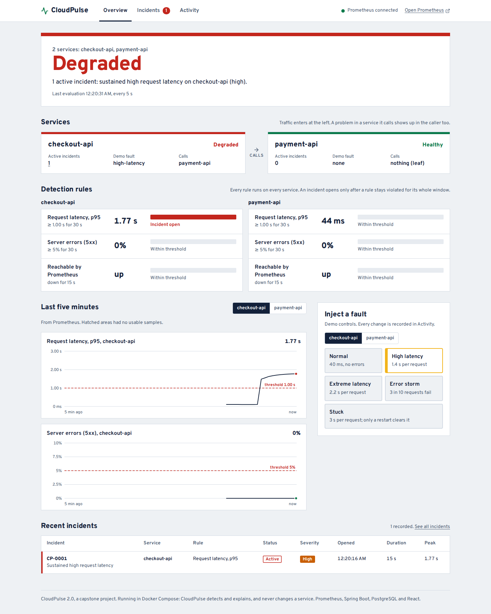
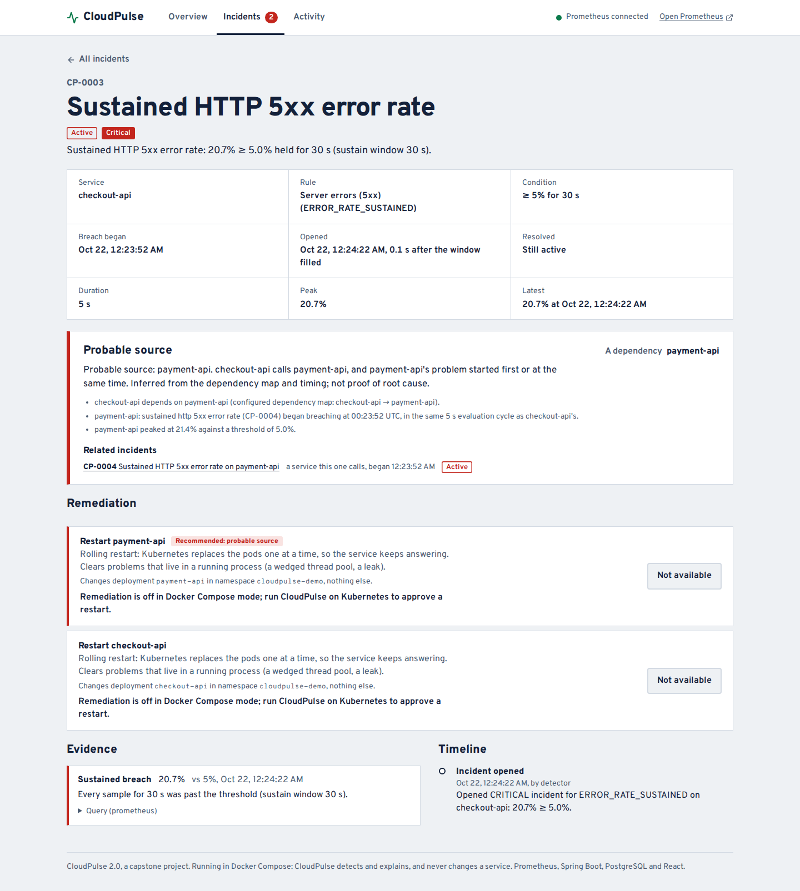
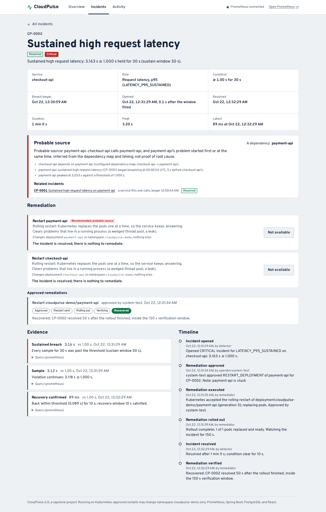
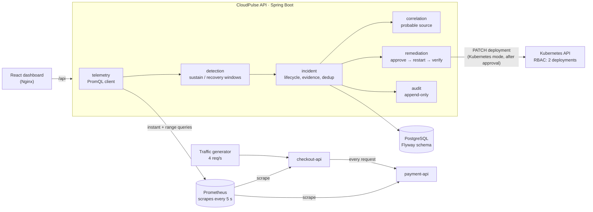
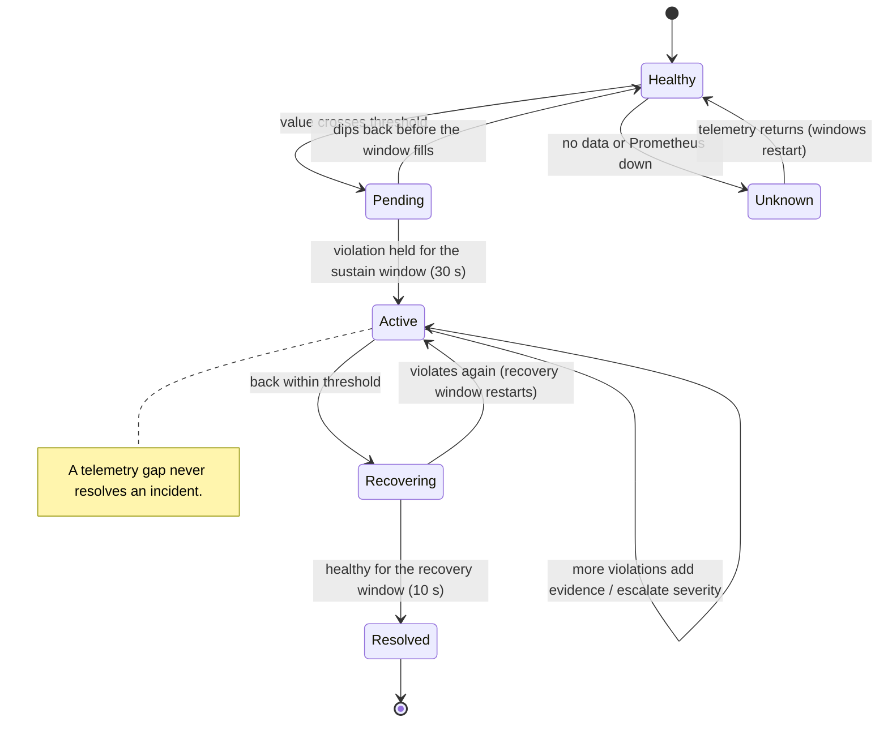
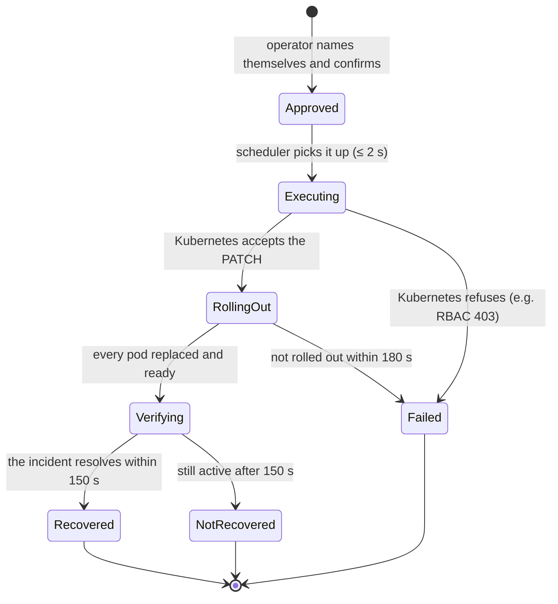

# CloudPulse

**Incident detection, probable-source diagnosis and approval-gated Kubernetes remediation for microservices, with the evidence and audit trail to back every decision.**

[](https://github.com/abhyudaithakur/CloudPulse_Final/actions/workflows/ci.yml)


CloudPulse watches two microservices (checkout-api, which calls payment-api) through Prometheus,
evaluates deterministic rules (p95 latency, 5xx error rate, reachability) and opens an incident
only when a violation is *sustained*. Each incident keeps the measurements that justify it, names
its **probable source** from the dependency map, and, on Kubernetes, can be fixed by a **guarded
restart** that runs only after a named operator approves it and is then verified against the
incident. When telemetry disappears, CloudPulse says "health unknown" instead of guessing.

It is a computer-science capstone project (solo), built to run entirely on a laptop: Docker
Compose for detection and diagnosis, and a local kind cluster for remediation. No cloud account,
no paid services.

<!-- screenshots: docs/images/*.png are captured by the CI system test from the real running stack -->


## What it does

| Capability | How |
|---|---|
| **Detects sustained problems, not blips** | A rule must stay violated for its whole window (30 s) before an incident opens; a dip restarts the window. |
| **One incident per problem** | Further violations add evidence to the open incident; severity escalates in place. A partial unique index enforces this in PostgreSQL, not only in code. |
| **Explains itself** | Every incident keeps timestamped evidence: value, threshold, source and the exact PromQL to re-run. |
| **Finds the probable source** | checkout-api calls payment-api. When payment breaks first, checkout's incident says *probable source: payment-api*, with the dependency path and timing. Missing dependency telemetry gives "inconclusive", never a guess. |
| **Fixes, but only with permission** | On Kubernetes, an operator approves *Restart payment-api* with their name and an explicit confirmation. CloudPulse patches only that deployment, watches the rollout, and records whether the incident actually resolved. |
| **Least privilege** | The API's Kubernetes identity may `get`/`patch` exactly two deployments in one namespace. CI proves it with `kubectl auth can-i`. |
| **Refuses to guess** | No data, NaN, or an unreachable Prometheus is reported as *unknown*. It never counts as healthy and never resolves an incident. |
| **Leaves an audit trail** | Incidents, faults, approvals, restarts, outcomes and telemetry outages are appended to an audit table that rejects `UPDATE` and `DELETE` (database trigger). |





## Architecture



The backend packages mirror the modules in the requirements document (RAD): `telemetry`,
`detection`, `incident`, `correlation`, `remediation`, `audit`, `monitoring`, `demo`. The two
decision cores are pure classes with no Spring, database or clock: `SustainedThresholdEvaluator`
(when does a violation become an incident) and `CorrelationEngine` (where did it start). Both are
unit-tested with synthetic time.

### Incident lifecycle



### Remediation lifecycle (Kubernetes mode)



Each step is saved before the next one. An attempt interrupted mid-call is marked *Failed*,
never retried without a new approval, and PostgreSQL allows only one in-progress remediation per
incident.

## Run it

Prerequisites: Docker Desktop (Windows/macOS) or Docker Engine with Compose (Linux). The full
Windows walkthrough, including the live demo script, is in [SETUP_WINDOWS.md](SETUP_WINDOWS.md).

### Docker Compose mode: detect and explain

```bash
git clone https://github.com/abhyudaithakur/CloudPulse_Final.git
cd CloudPulse
docker compose up --build -d
```

Open **http://localhost:3000**. After about a minute of traffic both services show **Healthy**.
Automated check: `powershell -ExecutionPolicy Bypass -File .\scripts\verify-demo.ps1` on Windows,
`python e2e/smoke_test.py` anywhere.

| URL | What |
|---|---|
| http://localhost:3000 | Dashboard |
| http://localhost:8080/api/dashboard | API (see below) |
| http://localhost:9090 | Prometheus |
| http://localhost:8081, :8082 | checkout-api, payment-api |

### Kubernetes mode: guarded remediation

```bash
docker compose down                                             # free the memory first
./scripts/k8s-up.sh                                             # Linux/macOS (needs kind + kubectl)
powershell -ExecutionPolicy Bypass -File .\scripts\k8s-up.ps1   # Windows (downloads kind + kubectl if missing)
```

The script builds the same images, creates a one-node [kind](https://kind.sigs.k8s.io/) cluster,
deploys [`deploy/k8s`](deploy/k8s) and waits for every pod. Then open **http://localhost:30080**
(Prometheus: http://localhost:30090). Automated check: `verify-demo.ps1 -Kubernetes` or
`python e2e/k8s_test.py`. Delete everything with `scripts/k8s-down`.

| Namespace | Runs |
|---|---|
| `cloudpulse` | API (service account `cloudpulse-api`), dashboard, PostgreSQL, Prometheus |
| `cloudpulse-demo` | checkout-api, payment-api, traffic generator: the only things CloudPulse may change |

## Demo scenarios

Inject faults from the dashboard (choose the service, then the fault) or `POST /api/demo/fault`.
CI runs every one of these on every push and records the timings; the run that produced the
screenshots is in [docs/images/measurements.md](docs/images/measurements.md).

| Fault | What the service does | What CloudPulse does |
|---|---|---|
| **High latency** (checkout) | adds 1.4 s per request | measured p95 ≈ 1.5–1.8 s (a histogram estimate) → latency incident, usually High |
| **Extreme latency** (checkout) | adds 2.2 s per request | the *same* incident escalates to Critical |
| **Error storm** (checkout) | 3 of every 10 requests return HTTP 500 | error-rate incident, Critical |
| **Error storm** (payment) | payment fails 3 in 10; checkout returns 502 for those | incidents on both; checkout's names **payment-api** as probable source |
| **Stuck** (payment) | 3 s per request; refuses to be cleared (HTTP 409); the pod stays "alive", so Kubernetes does not restart it | latency incidents on both, traced to payment. Compose: restart refused, explained. Kubernetes: approve the restart → rollout → **Recovered** |
| `docker compose stop checkout-api` | unreachable | availability incident after 15 s; health *Unavailable* |
| `docker compose stop prometheus` | no telemetry | health *Unknown*, values blank, outage audited; nothing resolves |
| **Normal** | back to 40 ms, no errors | incidents resolve 10 s after the rolling window drains |

## Rules (configuration, not code)

Rule *templates* in [`application.yml`](backend/src/main/resources/application.yml) are applied
to every configured service (`{service}` is replaced by its name), so adding a service gives it
all three rules. Thresholds and windows can be overridden with environment variables.

| Rule | PromQL (simplified) | Violates when | Severity |
|---|---|---|---|
| `LATENCY_P95_SUSTAINED` | `histogram_quantile(0.95, …{application="{service}"}[1m])` | p95 ≥ 1.0 s for 30 s | High at 1.5×, Critical at 2× |
| `ERROR_RATE_SUSTAINED` | 5xx rate ÷ total rate over 1 m | ≥ 5 % for 30 s | High at 10 %, Critical at 20 % |
| `TARGET_AVAILABILITY` | `min(up{job="{service}"})` | down for 15 s | always Critical |

## API

| Method | Path | Purpose |
|---|---|---|
| GET | `/api/dashboard` | Everything the overview needs in one call |
| GET | `/api/services` | Services, dependency map and telemetry-aware health |
| GET | `/api/rules` | Every rule on every service with its latest evaluation |
| GET | `/api/services/{service}/rules/{id}/series?minutes=5` | Metric history from Prometheus (gaps are `null`) |
| GET | `/api/incidents?status=&service=&rule=` | Incidents, newest first, each with its probable source |
| GET | `/api/incidents/{id}` | Detail: evidence, audit timeline, probable source, runbooks, remediations |
| GET | `/api/incidents/{id}/probable-source` | The correlation result alone |
| POST | `/api/incidents/{id}/remediations/RESTART_DEPLOYMENT/approve` | `{"targetService","operator","confirm":true,"note"}` → 202; executed asynchronously |
| GET | `/api/incidents/{id}/remediations` · `/api/remediations` · `/api/remediation` | Remediation history and whether remediation is enabled here |
| GET | `/api/audit` | The global audit trail |
| POST | `/api/demo/fault` `{"service","mode"}` | Demo only: `none`, `high-latency`, `extreme-latency`, `error-storm`, `stuck` |

Errors are RFC 9457 `application/problem+json`.

## Testing

| Level | What | Where |
|---|---|---|
| Unit | Window state machine, severity, correlation rules, dependency map, PromQL parsing, rollout logic, dashboard components | `backend/src/test` (`*Test`), demo service, dashboard (Vitest) |
| Integration | Real PostgreSQL via Testcontainers + Flyway; the HTTP API end to end for both services; the whole remediation flow against a scripted Kubernetes API, including RBAC refusal, timeouts and crash safety | `CloudPulseApiIT`, `RemediationIT` |
| System, Compose | The whole stack: every fault, probable source, stuck service, outages, 25 concurrent clients | [`e2e/smoke_test.py`](e2e/smoke_test.py) |
| System, Kubernetes | kind cluster: pod discovery, exact RBAC, stuck → approve → rollout → verified recovery, API restart safety | [`e2e/k8s_test.py`](e2e/k8s_test.py) |

Test names carry the requirement they verify (`fr08_…`, `nfr03_…`). On every push, CI builds a
**requirement traceability matrix** from the actual results and publishes it with the system-test
measurements and screenshots in the run summary ([catalog](docs/traceability/requirements.json)).

```bash
cd backend && mvn verify          # unit + integration (needs Docker for Testcontainers)
cd frontend && npm test           # dashboard tests
python e2e/smoke_test.py          # against a running Compose stack
python e2e/k8s_test.py            # against the kind cluster
```

No local Maven or Node? The Docker images run the unit tests while they build, so
`docker compose up --build` fails if a unit test fails.

## Design decisions

Short records of the choices worth questioning (why deterministic rules, why gaps reset windows,
why dedup lives in the database, why "probable" source, why approvals are executed later, why
RBAC and not only code) are in [docs/design-decisions.md](docs/design-decisions.md).

## Status

All functional and non-functional requirements of the RAD (FR-01 to FR-14, NFR-01 to NFR-10,
UC-01 to UC-06) are implemented and covered by automated tests at unit, integration or system
level; the CI traceability matrix shows which test verifies which requirement. Possible next
steps: OpenTelemetry traces as extra evidence, more runbooks (scale out, roll back), and
authentication for approvals.

## Repository map

```text
backend/            CloudPulse API (Spring Boot 4.1, Java 21): telemetry, detection, incident,
                    correlation, remediation, audit
demo-service/       Instrumented demo service (runs as checkout-api and payment-api) with faults
frontend/           React 19 + TypeScript dashboard (Vite), served by Nginx
prometheus/         Compose scrape configuration (both services and the API itself)
deploy/             Kubernetes mode: kind cluster config and Kustomize manifests with RBAC
traffic-generator/  Synthetic load (Python)
e2e/                System tests: Compose stack and Kubernetes mode
scripts/            k8s-up / k8s-down, verify-demo.ps1 (Windows demo check), traceability report
docs/               Design decisions, requirement catalog
.github/workflows/  CI: unit, integration, Compose and Kubernetes system tests, traceability
```

## Scope

CloudPulse is a teaching-scale project, not a replacement for Prometheus Alertmanager, Datadog
or PagerDuty. It has no authentication (the operator name on an approval is self-declared), no
multi-tenancy, TLS or alert routing, and it monitors two demo services. The local PostgreSQL
credentials are for this demo only.

Capstone: Computer Science Capstone Experience, Abhyudai Singh Thakur. MIT licensed.
